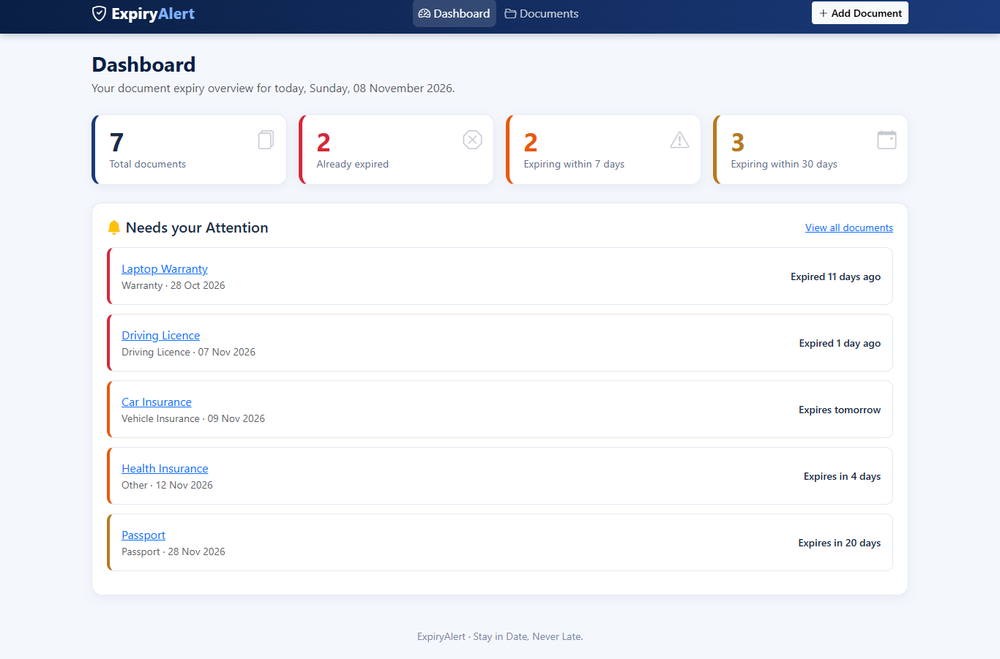
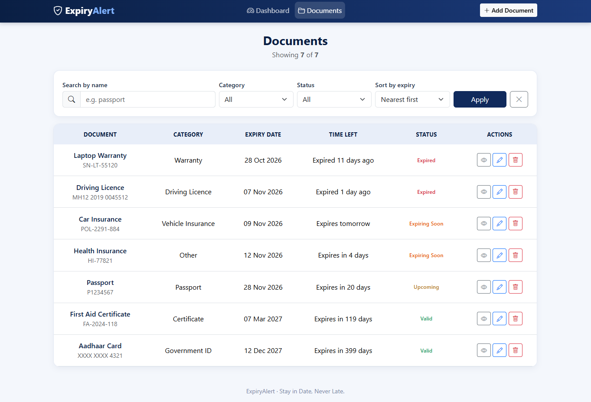
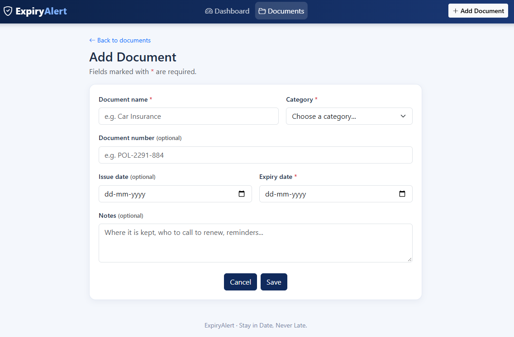
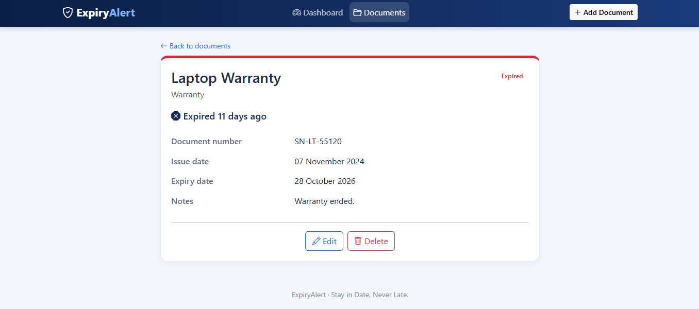
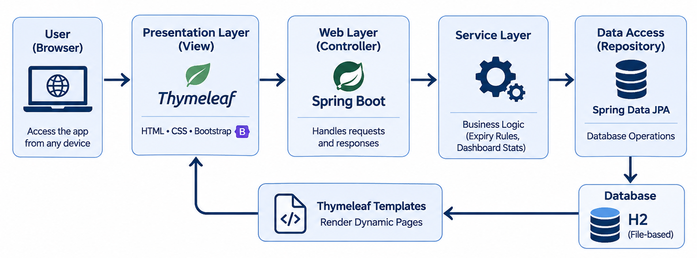

<h1 align="center">📄 ExpiryAlert — Smart Document Expiry Tracker</h1>

<p align="center">
  <strong>Stay in Date, Never Late.</strong>
</p>

A Java-based web application that helps users track important documents, monitor expiry dates, and stay ahead of renewals with a centralized dashboard and timely expiry alerts.

## ✨ Features

- 📊 **Dashboard** — Overview of total, expired, and upcoming documents.
- 🔔 **Expiry Alerts** — Highlights documents expiring within 30 days.
- 🗂️ **Document Management** — Add, view, edit, and delete documents.
- 🔎 **Search & Filters** — Find documents by name, category, or status.
- ↕️ **Sorting** — Organize documents by nearest or farthest expiry.
- ✅ **Validation** — Prevents invalid dates and missing required fields.
- 📱 **Responsive UI** — Clean navy-and-white design for desktop and mobile.
- 🚀 **Demo Data** — Sample documents available on first launch.

## 🖥️ Screenshots

### Dashboard


### Documents


### Add / Edit Document


### Document Details



## 🛠️ Tech Stack

| Layer | Technology |
|---|---|
| Language | Java 17+ |
| Backend | Spring Boot 3.5 |
| Frontend | Thymeleaf, HTML, CSS, Bootstrap 5 |
| Database | H2 (file-based) |
| Build Tool | Maven |
| Testing | JUnit 5, Spring Boot Test, MockMvc |

## 📌 Expiry Status Rules

| Days Remaining | Status |
|---|---|
| Less than 0 | 🔴 Expired |
| 0–7 days | 🟠 Expiring Soon |
| 8–30 days | 🟡 Upcoming |
| More than 30 days | 🟢 Valid |

A document expiring today is marked **Expiring Soon** and displays “Expires today.”

## ⚙️ Getting Started

### Prerequisites
- Java JDK 17 or newer
- VS Code (or another Java IDE)
- Internet connection for the initial dependency download

### Run locally on Windows

**1.** Clone or download this repository and open the project folder.

**2.** Verify Java is installed:

```powershell
java -version
```

**3.** Start the application using the Maven Wrapper:

```powershell
.\mvnw.cmd spring-boot:run
```

**4.** Open the application:

🌐 http://localhost:8080

### Run tests

```powershell
.\mvnw.cmd test
```


## 🏗️ System Architecture




## ⚙️ Configuration

Edit `src/main/resources/application.properties` to configure:

- **Port:** `server.port=8080`
- **Sample data:** `expiryalert.seed-sample-data=true`
- **Database:** Stored locally in the `data/` directory.

The H2 database console is available at http://localhost:8080/h2-console.

## 🚀 Future Enhancements

- Email and SMS reminders
- User authentication
- Document attachment uploads
- Customizable reminder periods
- Calendar export
- PostgreSQL/MySQL support

## 📄 License

Free to use for learning and portfolio purposes.
